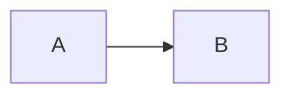

# AmberText export fixture

This disposable fixture tests **bold**, *italic*, ~~deleted text~~, ==highlight==, `inline code`, and a hard break.\
Second line with Danish æøå, Japanese 日本語, emoji 🪶, and mixed العربية English.

## Repeated heading

[External reference](https://example.invalid/research?q=writing&lang=en) and [local heading](#repeated-heading-1).

## Repeated heading

### 日本語 heading

[Unicode heading](#日本語-heading) and [other document](other.md#writing).

3. Third item
4. Fourth item
   - Nested bullet
     - Deeper bullet

- [ ] Unfinished task
- [x] Finished task

> A quoted paragraph with **emphasis**.
>
> A second quoted paragraph.

| Feature | Value |
|:--|--:|
| Unicode | æøå 日本語 |
| Formatting | **Strong** and *light* |


```js
const literal = "";
```

---

Unsupported examples must remain visible and produce diagnostics.

Inline equation $x^2 + y^2$ and footnote[^note].

[^note]: A footnote requiring explicit fallback review.



<div class="custom">Raw HTML sample</div>

> [!NOTE]
> An alert whose presentation differs from a plain quotation.
